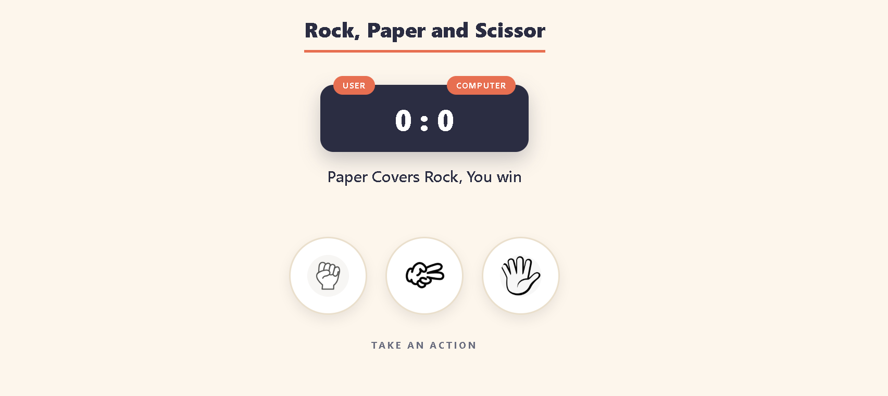
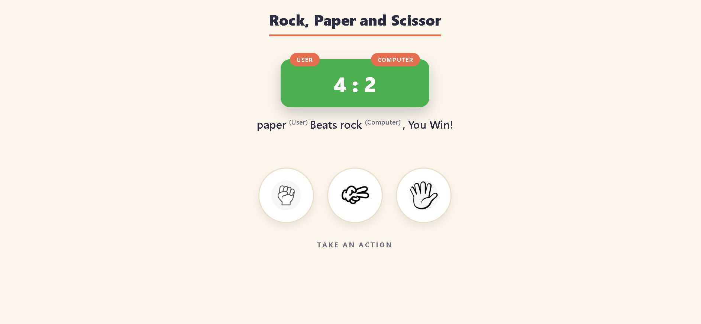

# Rock, Paper, Scissors

A classic hand game against the computer. Pick rock, paper, or scissors, and see who wins the round. The first player to 5 round wins takes the match.

## Screenshots

### Start of the game


### Round won


## How to Play

1. Click **rock**, **paper**, or **scissors**.
2. The computer makes a random choice.
3. The round result appears, and the scoreboard changes color:
   - Green: you won the round
   - Red: the computer won the round
   - Blue: draw
4. The first player to reach 5 points wins the match, and a popup asks if you want to play again.

## Features

- Random computer choice each round
- Live scoreboard with color feedback
- Hover animation on each choice
- Match-end popup with a play-again button
- Responsive layout for phones and desktops

## How to Run

1. Clone the repository:
   ```bash
   git clone https://github.com/abdallaahemd/Rock-Paper-Scissors.git
   ```
2. Open the project folder.
3. Open `index.html` in your browser.

## Project Structure

```
Rock-Paper-Scissors/
├── index.html      # Game layout
├── Fstyle.css      # Game styles
├── Fmain.js        # Game logic and popup
└── screenshots/    # Screenshots used in this README
```

## What I Learned

- Handling click events on multiple elements
- Using `Math.floor(Math.random() * 3)` to pick a random choice
- Comparing game rules with conditional logic
- Changing styles from JavaScript with `style.backgroundColor`
- Building a reusable popup with `createElement` and `innerHTML`

## Built With

- HTML
- CSS
- JavaScript

## Author

**Abdallah Ahmed**: Programming instructor and developer
- LinkedIn: https://www.linkedin.com/in/abdalla-konsowa-386414203
- itch.io: https://abdallak.itch.io/
